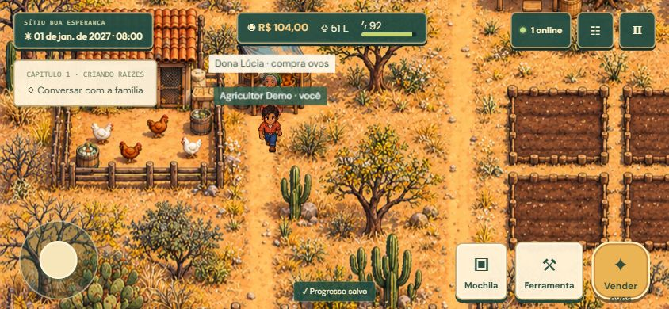

# VALE DO CAJU

Jogo web mobile-first sobre agricultura familiar em uma comunidade fictícia de Pacajus, Ceará. Primeiro capítulo jogável em 2027; não é a campanha completa até 2050.

## Executar

Requer Node.js 22.12+ (testado com 24) e npm.

```powershell
npm ci
Copy-Item .env.example .env
npm run seed
npm run dev
```

Abra http://localhost:5173. Conta **exclusivamente de desenvolvimento**: `demo@valedocaju.test`, senha definida em `DEMO_PASSWORD` no `.env` (exemplo: `ValeCaju#2027`). O caractere `#` exige aspas no arquivo `.env`. Execute o seed com o servidor parado se estiver usando PGlite. A conta não tem privilégios administrativos.

O terminal do Vite mostra também o endereço de rede. Para testar em um celular conectado ao mesmo Wi-Fi, use `http://IP-DO-COMPUTADOR:5173`. O firewall do computador precisa permitir essa conexão. HTTP local serve apenas para desenvolvimento; produção exige HTTPS. Tela cheia e instalação como aplicativo podem não estar disponíveis em HTTP ou em alguns navegadores.

## Como jogar

- A página abre diretamente no jogo. Uma primeira visita cria uma partida de visitante salva no servidor e vinculada ao cookie desta sessão.
- Em **Pausar → Guardar minha partida**, vincule e-mail e senha para continuar em outro aparelho, ou entre em uma conta existente. Sem vincular, perder o cookie ou deixar a sessão expirar impede recuperar o visitante.
- Use joystick ou setas. O mapa tem 10 galinheiros à esquerda, 10 cajueiros no alto à direita e 10 canteiros de feijão já plantados embaixo à direita.
- Passe sobre os produtos para recolher 3 unidades. A primeira coleta inicia 90 segundos de prazo real; outras coletas do mesmo produto aumentam a carga até 30, sem renovar o prazo.
- Siga a seta até a porteira sul e depois até o comprador na estrada. Toque **Entregar carga** junto a ele. Ovos: R$ 4; caju: R$ 3; feijão: R$ 8 por unidade.
- Cada ponto volta a produzir em 2 minutos. O prazo continua em menus, com a aba fechada e após reconectar; se vencer, a carga é perdida sem multa sobre o saldo.
- **Rotas** mostra o mapa. **Família online** mostra irmãos reais, atividade escolhida e caixa compartilhado. Produção, cargas e saldo são individuais.
- Mãe Rosa e Pai João ficam perto da casa. A cisterna fornece água; a mochila permite alimentar a família. Entre em casa e descanse para avançar o calendário e recuperar energia.
- O armazém e os compradores ficam fora do sítio. Produtos antigos na mochila ainda podem ser vendidos; cargas com prazo têm pagamento exclusivo pela entrega.

## Persistência e segurança

- Fastify + TypeScript. PostgreSQL externo via `DATABASE_URL`; sem essa variável, PGlite executa PostgreSQL embutido e persiste no servidor: `%LOCALAPPDATA%/ValeDoCaju/postgres` no Windows e `.data/postgres` nos demais sistemas; `PGLITE_DATA_DIR` substitui o caminho. Não é localStorage como banco de partidas. PGlite é para um único processo de desenvolvimento.
- Argon2id para senhas; sessão opaca com token aleatório, hash no banco e cookie HttpOnly/SameSite=Strict. Secure é obrigatório no modo de produção. Sessões duram sete dias.
- Consultas parametrizadas, validação Zod, limitação de requisições e proteção por origem nas operações de escrita.
- A conta é obtida da sessão: rotas de partida não aceitam um identificador de outro usuário.
- Dinheiro, inventário, água, energia, colheitas e compras são calculados pelo servidor. Comandos têm UUID, versão e registro atômico contra reenvio/concorrência. Movimentação tem limites de mapa, mas não há sistema antitrapaça de velocidade/colisão no servidor neste MVP.
- Cada comando salva imediatamente. Posição é salva periodicamente, ao ocultar a aba e ao voltar ao menu. Um comando pendente por conta fica no navegador para reenvio idempotente após reconexão. Isso não constitui modo offline completo: uma interrupção abrupta pode perder segundos de movimentação; não há progressão econômica offline.
- Nenhuma chave privada é enviada ao cliente. `.env` e `.data` são ignorados pelo Git. Faça backups do PostgreSQL antes de atualizações.

## Recuperação de senha

Configure `RESET_WEBHOOK_URL` e `RESET_WEBHOOK_TOKEN` no servidor. O endpoint deve receber por HTTPS um POST JSON `{email,url}` e enviar o link por e-mail usando um serviço autorizado. O token expira após 30 minutos, é armazenado como hash, é de uso único e a troca invalida todas as sessões. Sem integração configurada, a interface informa que a recuperação está indisponível. Nenhum e-mail é enviado neste ambiente por padrão.

## Produção

```sh
npm ci
npm run build
# Definir NODE_ENV=production, DATABASE_URL e APP_ORIGIN=https://seu-dominio
npm start
```

O servidor serve `dist/` e `/api` na mesma origem, porta `PORT` (padrão 3001). Use um proxy reverso HTTPS ou hospedagem Node.js que forneça TLS, e PostgreSQL persistente. Não execute o seed nem reutilize o banco de desenvolvimento em produção. Não publique `.env` ou `.data`. O Dockerfile oferece um ponto de partida; `compose.yaml` fornece somente PostgreSQL local opcional.

O manifesto prepara a apresentação standalone. Ainda faltam ícones raster em vários tamanhos, service worker e validação dos critérios de instalação PWA de cada plataforma. O jogo não promete funcionamento offline.

## Verificação

Os testes iniciam automaticamente uma API separada com banco temporário:

```sh
npm run build
npm test
npm audit
```

O comando `npm test` escolhe uma porta livre e um banco temporário fora da pasta do projeto. As contas de teste usam e-mails UUID em `.test`; sua partida de desenvolvimento não é alterada. Testam cadastro, login, logout, isolamento, cookies, CSRF, idempotência e conflitos; testes de domínio verificam economia, restrições de colheita, agricultura, chuva e modos de sobrevivência.

Verificações realizadas: compilação TypeScript/Vite, testes automatizados, login e criação de partida pelo navegador, uso da mochila e persistência, inspeção responsiva horizontal e vertical. Não foram realizados benchmarks de FPS, testes em hardware Android/iPhone real, testes de carga ou implantação pública.

## Escopo e próximas etapas

Implementado: mapa original ilustrado e integrado ao Phaser, câmera, personagem animado em quatro direções, colisões locais, casa explorável, família, diálogos por regras, cajueiros adultos, roçado, cisterna, galinheiro com produção e venda de ovos, feira, inventário, economia, cosmético, missões, caderno de descobertas, chuva e ciclo dia/noite por ações, modos História/Sobrevivência e persistência por conta.

Ainda não implementado: campanha longa, beneficiamento industrial, demais culturas, prédios expansíveis, estoque variável e negociação de comerciantes, IA generativa, doenças detalhadas, furtos/combate, pesquisa com participantes e validação de aprendizagem. Ciclos, produtividade, preços e chuva são fictícios e abreviados. Atualmente a separação não preserva o pedúnculo como um item separado; essa cadeia deverá ser ampliada antes de uso didático aprofundado.

Pesquisa fica **desativada**: não há rastreamento de estudantes. Antes da publicação, a instituição precisa definir responsável pelo tratamento, procedimentos para menores, canal de direitos, retenção, revisão jurídica/ética e revisão docente. Um futuro módulo deve armazenar eventos mínimos sob pseudônimo em tabela separada, com participação opcional e possibilidade de revogação, sem e-mail, nome, escola ou texto livre.

## Organização

- `shared/game.ts`: regras de domínio executadas pelo servidor; tipos e catálogo compartilhados.
- `server/`: autenticação, comandos, banco e seed.
- `src/world.ts`: mapa, renderização e controles de movimento Phaser.
- `src/main.ts`: telas, menus por toque, API e recuperação de comandos.
- `src/style.css`: visual responsivo e áreas seguras.
- `tests/`: testes de integração e regras.

O cenário, o protagonista e os seis NPCs retrô modernos foram gerados originalmente para este projeto com a ferramenta integrada de geração de imagens. Os arquivos PNG estão em `public/assets`; carregamento, quadros de animação, cultivos e efeitos são integrados por código. Não foram usados sprites de jogos existentes. A direção e os prompts estão em `docs/ART_DIRECTION.md`. Fontes DM Sans e Outfit são empacotadas localmente via Fontsource, com suas licenças no pacote; o navegador não precisa consultar Google Fonts.

Referências científicas: [Embrapa — O cajueiro](https://www.atermaisdigital.cnptia.embrapa.br/web/caju/o-cajueiro), [Embrapa — Caju: 500 perguntas e respostas](https://www.infoteca.cnptia.embrapa.br/infoteca/bitstream/doc/1015476/2/500-perguntas-caju.pdf), [IBGE — Pacajus](https://www.ibge.gov.br/cidades-e-estados/ce/pacajus.html).

## Histórico: versão 0.2 — família online e retrô moderno

- Novo cenário detalhado, protagonista com quatro direções e animação, Mãe Rosa, Pai João e quatro comerciantes com aparências próprias.
- O botão **Família online** mostra os jogadores reais conectados como irmãos, seus nomes e atividades. Escolha galinheiro, pomar, horta ou água. Não há jogadores falsos: com apenas uma conta, o painel mostra uma pessoa.
- Atualizações a cada dois segundos, interpolação visual e expiração após 12 segundos sem contato. Todos participam de uma família global nesta versão (até 100 presenças retornadas por consulta); ainda não há salas privadas nem testes de carga.
- Cada irmão tem sua própria mochila, saldo, colheitas e calendário. Presença e caixa da família são compartilhados; este é um primeiro modo cooperativo, não uma simulação com todos os canteiros e relógios sincronizados.
- **Galinheiro:** 1 ração + 8 energia → 6 ovos, uma vez por dia por jogador. Dona Lúcia compra por R$ 4 cada e vende ração por R$ 6. Bento compra caju/castanha perto do pomar; Ana compra feijão e vende sementes perto da horta. O armazém central continua disponível.
- Contribuições voluntárias entram no caixa comum de forma atômica, junto com a atualização do saldo individual. Repetir uma requisição não cobra duas vezes. Aos R$ 300, aparece um cantinho da família no quintal de todos.
- O dinheiro é somente do jogo. Não existem pagamentos reais.

### Banco local e desenvolvimento no Windows

Não mantenha o banco ativo em uma pasta sincronizada pelo OneDrive: arquivos de bloqueio podem ficar indisponíveis. O padrão para novas instalações no Windows fica em LocalAppData. O caminho pode ser configurado por `PGLITE_DATA_DIR`. Preserve cópias antes de migrar uma instalação existente; não apague o banco para resolver um erro de inicialização.

O Vite atualiza o frontend automaticamente. O backend não é reiniciado a cada edição, para evitar interrupções frequentes do banco embutido. Após alterar `server/` ou regras em `shared/`, encerre e execute novamente `npm run dev`.

### Validação desta revisão

Nove testes automatizados cobrem autenticação, isolamento, idempotência, agricultura, sobrevivência, ciclo do galinheiro, preços, proximidade de compradores, presença de duas contas e contribuição concorrente. O teste adicional verifica a entrega do HTML e das três artes no build de produção. A compilação TypeScript/Vite e as inspeções de interface complementam os testes. Android/iPhone reais e carga com muitas pessoas continuam pendentes.

A inspeção no navegador verificou o galinheiro, o bloqueio de coleta repetida, a venda de seis ovos (saldo de R$ 80 para R$ 104), dois irmãos conectados com atividades distintas e o layout em paisagem. A posição da conta demo foi preparada pela API para testar as áreas de atividade. A captura `artifacts/retro-cooperativo.png` mostra essa sessão de teste; a conta auxiliar saiu ao terminar.

### Ambientação semiárida

O cenário final mantém a identidade retrô moderna com solo arenoso, capim seco, cactos, vegetação de caatinga, casas mais simples e barreiro com pouca água. A revisão visual preserva as posições interativas e representa a época seca da comunidade fictícia.




## Versão 0.3 — setores, entregas e abertura direta

Implementa os 30 pontos de produção, compradores fora da propriedade, coleta por proximidade, prazo de entrega persistido e validado pelo servidor, indicação da rota e entrada sem tela de apresentação. Controles de madeira e ícones originais integram a interface ao cenário.

Validação local: build TypeScript/Vite e 15 testes aprovados, incluindo relógio de entrega, reposição, bloqueio de carga mista, duplicação de pagamento, mapa ampliado, visitante e vinculação de conta preservando progresso. Inspeção no navegador confirmou abertura direta de conta existente e visitante, duas presenças e controles em paisagem. Não há validação de carga nem em aparelhos físicos.

### Hospedagem

O GitHub mantém o código. GitHub Pages sozinho não executa Fastify/PostgreSQL, portanto não atende ao jogo completo. `server.ts` e `vercel.json` preparam a implantação Fastify na Vercel; a implantação remota ainda precisa ser executada e validada. Configure PostgreSQL persistente por `DATABASE_URL`, `NODE_ENV=production` e `APP_ORIGIN` com a origem HTTPS final. A conta demo e o banco local não devem ser copiados para produção. Não foi publicado um endereço público nesta revisão.
